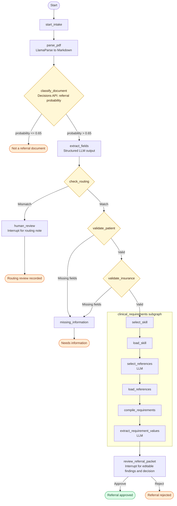

# Referral Intake Agent

Healthcare referral chat for a receiving practice. A Deep Agents `stream_agent`
uses UF Navigator to answer chat questions and decide when to call its referral
intake tool. The tool runs the LangGraph workflow that parses and classifies PDFs,
extracts fields, validates required data, and prepares orthopedic knee findings
for coordinator review.

See the [project brief](healthcare_referral_ai_project_brief.md) for the project
outline, implemented scope, and future work.

## Workflow



See the [full workflow document](docs/referral-intake-agent-flow.md) for node behavior and state.

## Setup

```bash
python3 -m venv .venv
.venv/bin/python -m pip install -e '.[dev]'
```

Set the parser, model, and local Agent Server credentials in `.env`:

```dotenv
LLAMA_CLOUD_API_KEY=
OPENAI_API_KEY=
NAVIGATOR_API_KEY=
NAVIGATOR_MODEL=
LANGSMITH_API_KEY=
```

The stream_agent and extraction share the Navigator model configuration.
Document classification uses an OpenAI Decisions API predicate on the parsed
Markdown. It continues to extraction only when the returned probability exceeds
`REFERRAL_PROBABILITY_THRESHOLD` (`0.65`), defined in
`src/referral_intake/classification.py`.

## Run the app

Start Docker, then run from the repository root:

```bash
.venv/bin/langgraph up --wait --docker-compose compose.local.yml
```

The backend runs at `http://localhost:8123`; `--wait` returns when its containers
are healthy. Set this value in `frontend/.env.local`:

```dotenv
NEXT_PUBLIC_LANGGRAPH_API_URL=http://127.0.0.1:8123
```

Then start the UI:

```bash
cd frontend
npm install
npm run dev
```

Open `http://localhost:3000`. Every message and PDF upload goes through
`stream_agent`. “Start a referral intake” prefills the editable composer; the
agent decides from the conversation whether to reply, process the PDF, or display
a registered referral component.
Responses stream into the chat after a shimmering thinking indicator.
Tool calls appear in a collapsible activity panel with the tool name and its
running, completed, failed, or waiting-for-review status.

Each chat supports one PDF. Use `New chat` for another packet. Coordinator review
pauses that thread and disables its composer; approving or rejecting resumes the
same checkpoint, completes the agent reply, and keeps the thread available for
follow-up questions. Non-referral documents stop before extraction and review.

## State and controlled UI

Business nodes save referral data, validation results, outcomes, and review records.
They do not store `ui` or `workflow`. The clinical subgraph receives only Markdown
and extracted fields and returns clinical requirements; its working data stays private.

The intake tool sends public field changes (`referral_delta`) and compact milestone
updates (`referral_progress`). Markdown and private working fields stay in the graph.
The frontend owns milestone copy and derives required review components from interrupts.
Busy referral rows have no link; direct visits wait until the run pauses or completes.

Stream can choose `referral_summary` or `clinical_findings` through `present_referral`.
Stream selects relevant facts from the saved intake result and sends labeled rows
with its component choice. React validates and renders the card payload.
Cards persist in conversation history. Only the existing human-review forms can
submit a referral decision. No CopilotKit or A2UI
integration is needed for this controlled component model.

Stream uses `deepagents==0.7.34` with its default virtual filesystem and delegation
capabilities. Custom backends, sandboxes, interpreters, and execution configuration
are deferred. The existing UF Navigator model and Agent Server identity are preserved.

### Code map

| Location | Responsibility |
| --- | --- |
| `src/referral_intake/stream_agent.py` | Prompt, Deep Agent creation, and live-event registration. |
| `src/referral_intake/tools.py` | Intake execution and the read-only `present_referral` tool. |
| `src/referral_intake/presentation.py` | Allowed component names, tool input validation, and progress projection. |
| `src/referral_intake/public.py` | One allowlist for public snapshots, tool results, and interrupts. |
| `frontend/src/lib/referral-presentation.ts` | Validate card payloads and derive automatic progress/review UI. |
| `frontend/src/components/referral-ui.tsx` | Registry mapping approved component names to React components. |

Stream can add text alongside a card when it provides information the card does
not cover. Progress and required review forms appear automatically from live events
and interrupts.

`CustomTransformer` registration is required for the current v3 streaming setup:
without it, referral deltas and progress do not reach the frontend's custom channel.
Optional presentation cards use persisted tool messages and do not depend on it.

## Sample knee referral PDFs

Use the PDFs in [knee_test_suite](knee_test_suite/) to try the intake workflow.
Attach one packet in the app to start a new referral case.

- [KNEE-100](knee_test_suite/KNEE-100.pdf)
- [KNEE-101](knee_test_suite/KNEE-101.pdf)
- [KNEE-102](knee_test_suite/KNEE-102.pdf)
- [KNEE-103](knee_test_suite/KNEE-103.pdf)
- [KNEE-104](knee_test_suite/KNEE-104.pdf)
- [KNEE-105](knee_test_suite/KNEE-105.pdf)
- [KNEE-106](knee_test_suite/KNEE-106.pdf)

## Restart, rebuild, and storage

Start existing containers from the repository root:

```bash
./scripts/start-langgraph.sh
```

The script waits for PostgreSQL and Redis, reconnects the API to `stream_default`
if its network attachment is missing, and checks the API on port `8123`.

After backend code or dependency changes, rerun the `langgraph up` command above,
including the Compose file. Restarting alone keeps the packaged code unchanged.

- PostgreSQL stores threads and checkpoints; keep its volume to retain them.
- Next.js saves PDFs in repo-local `data/uploads`. The Compose file mounts it
  read-only as `/uploads` in the backend; the UI translates paths for PDF viewing.
- Agent Server manages checkpointing. No database connection or checkpointer is
  required in graph code. PDF files are separate from database state.
- Only `stream_agent` is registered as an assistant. `referral_intake` runs inside
  its tool and shares the conversation's thread; it is not a separate assistant.

See [conversation persistence](docs/conversation-persistence.md) for threads,
runs, checkpoints, and storage behavior.

## Backend-only development

```bash
.venv/bin/langgraph dev --no-browser
```

This runs on port `2024` and saves state in `.langgraph_api`. Submit a host-readable
PDF path through Studio or the SDK. The UI's `/uploads` paths require the Docker
mount and do not work unchanged with this mode.

Finish existing paused referrals before deploying this graph-schema change. Older
completed artifacts and UI messages remain readable; stored checkpoints are not
rewritten. Rebuild the backend image to install Deep Agents and load the new code.
