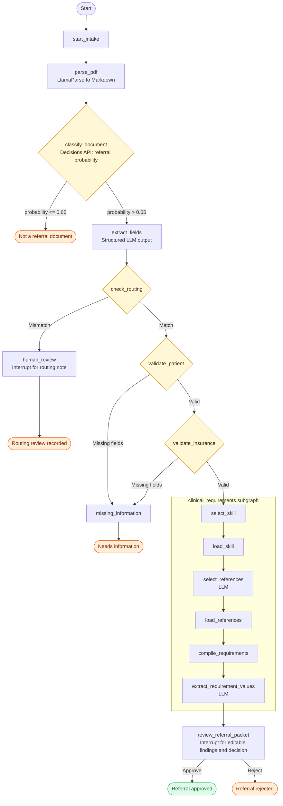

# Referral intake flow

[Setup and operation](../README.md) · [Standalone diagram](referral-intake-agent-flow.mmd)

## stream_agent

- Both frontend `useStream` hooks use the Deep Agent created with
  `create_deep_agent`, the existing UF Navigator model, and SDK defaults.
  Agent Server registers it as `stream_agent` for persistence and streaming.
- `referral_intake` reads the attached PDF from message metadata and runs the
  deterministic intake graph. `present_referral` selects a read-only summary
  or findings component using saved data. Its strict input schema accepts only
  the component choice; the runtime is injected by LangChain.
- Default virtual filesystem and delegation tools come from Deep Agents.
  Custom backends, interpreters, and sandboxes are deferred.
- Upload metadata travels in `additional_kwargs.referral`. Each chat supports
  one PDF. An upload without instructions does not force intake.
- Public referral deltas and compact milestone events drive live progress;
  completed results and optional presentation requests persist as tool artifacts.
- Routing and clinical interrupts pause the same tool and thread. Review resumes
  the checkpoint without repeating parsing. The composer waits for review.
- AI Elements renders attachments, tool activity, streamed text, and registered
  presentation cards. Chat-only threads are excluded from referral queues.
- Busy rows cannot navigate. Direct detail URLs poll until the run pauses or
  completes before loading the saved record. Deferred uploads remain navigable.

## Intake graph

Fixed sequences use static edges and ordinary state updates. Classification,
routing, and patient/insurance validation retain conditional `Command` routing.
Node boundaries and required review checkpoints are preserved.

| Node | Behavior |
| --- | --- |
| `start_intake` | Record `processing`, then parse the PDF. |
| `parse_pdf` | Parse Markdown, then classify. |
| `classify_document` | Referral → extraction; unrelated document → `END`. |
| `extract_fields` | Extract the nested referral schema, then check routing. |
| `check_routing` | Match → validate patient; mismatch → routing review. |
| `human_review` | Interrupt for a routing note, save `human_reviewed`, then end. |
| `validate_patient` | Valid → validate insurance; missing → missing information. |
| `validate_insurance` | Valid → clinical requirements; missing → missing information. |
| `missing_information` | Finalize `needs_information`, then end. |
| `clinical_requirements` | Return draft clinical requirements/findings for review. |
| `review_referral_packet` | Interrupt for edited findings and a human decision, save it, then end. |

## Classification

- OpenAI Decisions (`gpt-6-luna`, `OPENAI_API_KEY`) returns a referral predicate
  `probability`, stored in `DocumentClassification`. Its `is_referral` property is
  true only above `REFERRAL_PROBABILITY_THRESHOLD` (`0.65`); equality ends intake.
  See [classification instructions](../src/referral_intake/classification.py).
- Accept patient-specific referral intent, regardless of specialty or missing details.
- Reject standalone records, blank forms, and unrelated documents without referral intent.
- Rejection sets `not_referral_document`, skips extraction and review, and displays
  “Not a referral document. Please upload a patient referral packet.”
- Packet progress stays active through parsing and classification.
- Empty Markdown, API failures, refusals, and invalid output are run errors.

## Clinical subgraph

- Supports `orthopedics/knee`: ACL, meniscus, and osteoarthritis; general consultation
  and surgical evaluation.
- Skill selection, file loading, and requirement compilation are deterministic.
- The LLM selects reference IDs and extracts findings from Markdown.
- Requirements include IDs, display descriptions, optional `guidance`, required flags,
  and sources. Findings include the requirement ID, documentation status, and value.
- Coordinators review clinical gaps. Missing required patient or insurance data stops
  the workflow before clinical extraction.
- Automatic clinical follow-up, scheduling, and other specialties are not implemented.

## State and UI

- `stream_agent` input: `messages`. Uploaded PDF details are message metadata;
  the visible message text also tells the model that a PDF was attached.
- The intake tool has no model-supplied arguments. It reads `pdf_path` and optional
  `pdf_name` from the latest attached referral message.
- Results: Markdown, classification, extracted fields, validated patient and insurance
  data, and clinical findings.
- Status: `outcome`, `message`, `missing_fields`, and `review_text` as applicable.
- Clinical review pauses with an interrupt; the outcome remains `processing` until a decision.
- Business state contains no `workflow` or `ui`. Public field deltas and compact
  progress events are projected by the intake tool; the frontend supplies milestone
  labels and required review components from interrupts. Markdown and clinical
  working fields are excluded from public snapshots.
- Stream uses Deep Agents defaults. Its `present_referral` tool selects a registered
  summary or findings card and supplies labeled rows drawn from the saved result.
  Cards persist as tool artifacts, independently of the business graph.
- `GraphDependencies` keeps service clients and routing policy outside saved state.
  Subgraph input/output schemas keep internal instructions and working fields private.
- See the [README](../README.md#restart-rebuild-and-storage) for persistence and PDF storage.
